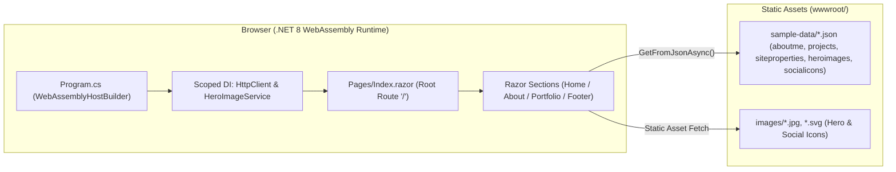

# NETWasm

> **.NET 8 Blazor WebAssembly 클라이언트 사이드(CSR) 정적 포트폴리오 웹 애플리케이션**


`NETWasm`은 별도의 백엔드 서버 프로세스 없이 브라우저 내 **.NET 8 WebAssembly 런타임**에서 100% 클라이언트 사이드 렌더링(CSR)으로 동작하는 **데이터 기반(JSON-Driven) 개인 포트폴리오 SPA 템플릿**입니다.

---

## 1. Why (제작 목적 및 배경)

C#/.NET 생태계 기반 개발자가 JavaScript/TypeScript 프레임워크 없이도 **단일 언어(C# + Razor)만으로 정적 웹 호스팅(GitHub Pages, Azure Static Web Apps)이 가능한 반응형 포트폴리오 웹앱**을 구축·검증하기 위해 구성한 프로젝트입니다.

- **무서버(Serverless Static) 아키텍처**: DB나 API 서버 없이 `wwwroot/sample-data/*.json` 정적 데이터 파일만 수정하면 이름, 직함, 자기소개, 보유 기술, 프로젝트 카드, 소셜 링크가 즉시 반영됩니다.
- **강타입 C# 모델 & 서비스 분리**: `HttpClient.GetFromJsonAsync<T>()`와 `HeroImageService` 의존성 주입(DI)을 통해 정적 JSON을 강타입 C# 모델(`SiteProperties`, `AboutMe`, `Project`, `HeroImage`, `SocialIcons`)로 안전하게 바인딩합니다.
- **CI/CD 자동 배포 파이프라인 내장**: GitHub Pages 자동 빌드·배포 워크플로우(`.github/workflows/publish-gh-pages.yml`)와 Azure Static Web Apps CLI 설정(`swa-cli.config.json`), Dev Container 환경을 기본 포함합니다.

---

## 2. What (핵심 기능 및 화면 구성)

단일 페이지(`Pages/Index.razor`, 경로 `/`) 안에서 스크롤 내비게이션으로 연결된 **5개 모듈형 Razor 섹션**으로 구성됩니다.

| 컴포넌트 | 파일 경로 | 바인딩 JSON 데이터 (`wwwroot/sample-data/`) | 화면 역할 |
| :--- | :--- | :--- | :--- |
| **`Header`** | `Layout/Header.razor` | 정적 앵커 (`#home`, `#about`, `#portfolio`, `#footer`) | 상단 고정 스크롤 내비게이션 바 |
| **`Home`** | `Components/Home.razor` | `siteproperties.json` + `heroimages.json` (`name == "home"`) | 풀스크린 히어로 배너, 이름·직함 타이틀, 하단 스크롤 유도 버튼 |
| **`About`** | `Components/About.razor` | `aboutme.json` + `heroimages.json` (`name == "about"`) | 자기소개 요약, 2단 컬럼 핵심 역량(`Skills`) 리스트, 철학/인용구 |
| **`Portfolio`** | `Components/Portfolio.razor` | `projects.json` + `heroimages.json` (`name == "portfolio"`) | 대표 프로젝트 카드 그리드 및 외부 레포지토리/아티클 새 창 링크 |
| **`Footer`** | `Layout/Footer.razor` | `siteproperties.json` + `socialicons.json` | GitHub, LinkedIn, YouTube, 이메일 등 소셜 아이콘 링크 및 테마 컬러 적용 |

---

## 3. How (아키텍처 및 코드 구조)

### 3.1 클라이언트 사이드 렌더링(CSR) 동작 흐름



### 3.2 디렉토리 구조

```text
NETWasm/
├── MyPortfolio.sln                         # Visual Studio 솔루션 파일
├── global.json                             # .NET 정식 릴리스 SDK 사용 정책 정의
├── swa-cli.config.json                     # Azure Static Web Apps 로컬 에뮬레이터 설정 (Port 5000)
├── .github/workflows/publish-gh-pages.yml  # GitHub Pages 정적 WASM 퍼블리시 워크플로우
└── src/BlazorApp/
    ├── BlazorApp.csproj                    # net8.0 Microsoft.NET.Sdk.BlazorWebAssembly 프로젝트
    ├── Program.cs                          # 루트 컴포넌트(#app) 마운트 및 HttpClient/HeroImageService 등록
    ├── Pages/Index.razor                   # 메인 포트폴리오 조합 페이지
    ├── Components/                         # Home.razor, About.razor, Portfolio.razor
    ├── Layout/                             # MainLayout.razor, Header.razor, Footer.razor (+ Scoped CSS)
    ├── Models/                             # AboutMe.cs, HeroImage.cs, Project.cs, SiteProperties.cs, SocialIcons.cs
    ├── Services/HeroImageService.cs        # 조건식(Predicate) 기반 히어로 배경 이미지 조회 서비스
    └── wwwroot/
        ├── index.html                      # Blazor WASM 부트스트랩 엔트리 HTML
        ├── css/                            # app.css 및 Bootstrap 스타일시트
        ├── images/                         # 배경 이미지 및 소셜 미디어 SVG 아이콘
        └── sample-data/                    # 포트폴리오 콘텐츠 정의 JSON 5종
```

---

## 4. Quick Start (로컬 빌드 및 즉시 실행 가이드)

외부 DB, API 키, 추가 패키지 설치 없이 **.NET 8.0 SDK**만 있으면 로컬에서 즉시 실행됩니다.

### 4.1 사전 요구사항

- **.NET 8.0 SDK** 이상 (`dotnet --version` `8.0.x`)

### 4.2 로컬 개발 서버 즉시 실행

```bash
git clone https://github.com/tejo1990/NETWasm.git
cd NETWasm

# Blazor WebAssembly 로컬 개발 서버 실행 (기본 포트: 5000)
dotnet run --project src/BlazorApp/BlazorApp.csproj --urls "http://localhost:5000"
```

실행 후 브라우저에서 **`http://localhost:5000`** 으로 접속하면 즉시 포트폴리오 화면을 확인할 수 있습니다.

### 4.3 정적 파일 빌드 (GitHub Pages / 정적 웹서버 배포용)

```bash
dotnet publish src/BlazorApp/BlazorApp.csproj -c Release -o release
# 생성된 release/wwwroot 디렉토리를 임의의 정적 파일 서버로 서빙 가능
```
